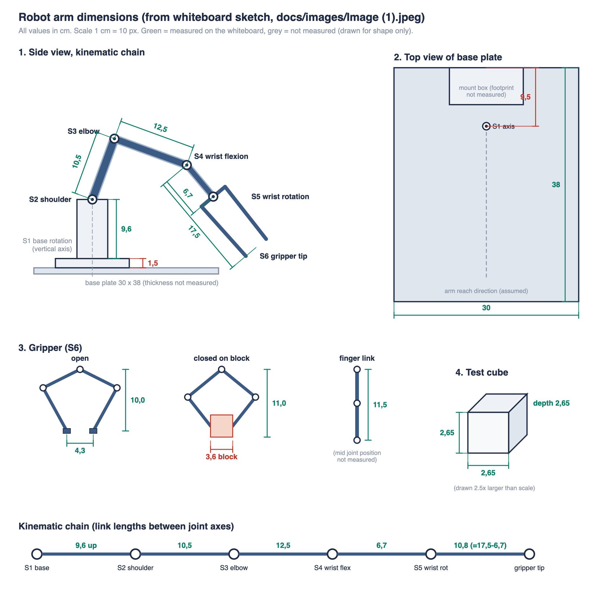

# Robot arm dimensions

Source: whiteboard sketch `docs/images/Image (1).jpeg`.
Diagram: `docs/images/arm-dimensions.svg` (PNG copy: `arm-dimensions.png`,
generator: `docs/images/make_arm_dimensions_svg.py`).

All values in **cm**. Values marked (?) are interpretations of the sketch and should be checked.
Joint names follow `docs/servo-calibration.md`.

## 1. Values read from the whiteboard

| Item | Value | What it measures |
|------|-------|------------------|
| Base plate width | 30 | Long front edge of the base plate |
| Base plate depth | 38 | Side edge of the base plate |
| Base plate thickness | not measured | |
| Mount plate height | 1,5 (?) | Red bracket next to the small plate the arm sits on |
| S1 axis to plate edge | 9,5 | "Distance centre to base edge", top view. S1 sits centred on the 30 cm width (?) |
| S1 to S2 height | 9,6 | From top of mount plate up to the shoulder axis (?) |
| S2 to S3 | 10,5 | Shoulder axis to elbow axis |
| S3 to S4 | 12,5 | Elbow axis to wrist flexion axis |
| S4 to S5 | 6,7 | Wrist flexion axis to wrist rotation joint (labelled "joint") |
| S4 to gripper tip | 17,5 | Wrist flexion axis to the end of the gripper fingers |
| Gripper height, open | 10,0 | Top finger pivot to finger tips |
| Gripper tip gap, open | 4,3 | Distance between finger tips when fully open |
| Gripper height, closed on block | 11,0 | Top pivot to tips while holding a block |
| Block width in gripper | 3,6 (?) | Written as "13,6 cm", leading stroke read as a dimension tick |
| Finger link, stretched | 11,5 | Full finger length, pivot to tip |
| Test cube | 2,65 x 2,65 x 2,65 | Object to pick up |

Derived: S5 to gripper tip = 17,5 - 6,7 = **10,8**.
This matches the closed gripper height (11,0) within measuring accuracy.

## 2. Blender setup

Units: set the scene to metric, 1 unit = 1 m, so every value below is divided by 100.

Coordinate system:

- Origin at the top surface of the base plate, directly under the S1 axis.
- Z points up. Y points from the back edge (where the arm sits) toward the front. X is along the 30 cm width.

### Base plate

| Object | Size X | Size Y | Size Z | Position of centre (x, y, z) |
|--------|--------|--------|--------|------------------------------|
| Base plate | 30 | 38 | thickness t (not measured, 1,0 as placeholder) | (0, 9,5, -t/2) |
| Mount plate | not measured, 12 as placeholder | not measured, 6 as placeholder | 1,5 | (0, -0,5, 0,75) |

The base plate centre sits 9,5 cm in front of the S1 axis, because the S1 axis is 9,5 cm from the back edge and the plate is 38 deep: 19 - 9,5 = 9,5.

### Joint origins in the straight-up zero pose

Every joint stacked vertically above S1. This is a modelling pose, not the servo home position.

| Joint | Name | Origin (x, y, z) | Rotation axis | Link to next joint |
|-------|------|------------------|---------------|--------------------|
| S1 | Base rotation | (0, 0, 1,5) | Z (vertical) | 9,6 up |
| S2 | Shoulder | (0, 0, 11,1) | X (pitch) | 10,5 |
| S3 | Elbow | (0, 0, 21,6) | X (pitch) | 12,5 |
| S4 | Wrist flexion | (0, 0, 34,1) | X (pitch) | 6,7 |
| S5 | Wrist rotation | (0, 0, 40,8) | Z of the link (roll) | 10,8 |
| Tip | Gripper tip | (0, 0, 51,6) | | |

Total height in zero pose above the base plate: **51,6**.
Maximum horizontal reach from S2 with the arm stretched out: 10,5 + 12,5 + 17,5 = **40,5**.

Suggested armature: one bone per link, parented in chain order S1, S2, S3, S4, S5, with the gripper as a child of S5.
Lock each bone to its single rotation axis from the table.

### Gripper (S6)

Four-bar style gripper with three pivots at the top and two fingers.

- Open: 10,0 high, finger tips 4,3 apart.
- Closed on a block: 11,0 high, block 3,6 wide.
- Each finger is 11,5 long when stretched, with a middle pivot whose position was not measured.

## 3. Open questions

- **9,6 reference:** does it start at the top of the mount plate or at the top of the base plate? This changes every Z value by 1,5.
- **1,5:** is it the mount plate thickness, or an offset of the arm centre from the mount plate edge? The red note "Distance centre to base edge" stands right next to it.
- **Block width 3,6 vs test cube 2,65:** the gripper sketch shows a 3,6 cm object, but the test cube is 2,65 cm. Are these two different objects?
- **Not measured:** base plate thickness, mount plate footprint, link widths, servo body sizes, and the finger middle pivot position.
- **Home pose angles:** to place the model in the servo home position (320 / 427 / 403 / 220 / 480 / 650), we need the joint angle at each home tick value.
