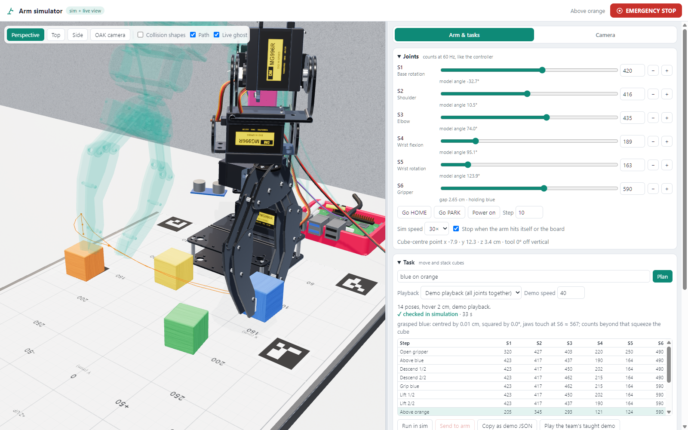

# three.js arm simulator

A browser simulator of the 6DOF arm: three.js for drawing, everything else is our own code (the Unreal and MuJoCo routes were dropped).
Everything runs in the browser: kinematics, the controller's motion rules, collision checks, cube physics, planning, camera calibration and cube recognition.
There are no npm dependencies; three.js r170 is vendored in `vendor/`.
Node is only needed for the small server and the tests.



## Run

```powershell
cd threejs-sim
node server.mjs                        # page + the robot API on a shared simulated arm, http://127.0.0.1:8770/
node server.mjs --camera http://10.102.4.103:8765                      # + the REAL camera (GET /api/camera/* only), "npm run lab"
node server.mjs --controller http://10.102.4.103:8765                  # + the real arm as a second backend, READ ONLY
node server.mjs --controller http://10.102.4.103:8765 --allow-motion   # only when the team agrees, someone at the stop button
node --test test/*.test.mjs            # 29 tests: kinematics, controller, collision, physics, planning, calibration, photo fit, API backend
node tools/fit-views.mjs --joint       # fit camera and arm pose of the reference photos (docs/model-photo-comparison.md)
node tools/compare.mjs                 # render model | photo | overlay for each reference photo into docs/images/compare/
```

`--port` and `--host` change the address. The API for other programs (the controller's low-level API, switchable between the simulation and the real arm): `docs/arm-api.md`.
Opening `index.html` straight from disk does not work, because browsers block ES modules from `file://`.

## What it does

| Area | Behaviour |
|------|-----------|
| Model | Joint distances from the schematic (`docs/images/arm-dimensions.png`), checked on the rendered model: 9,6 / 10,5 / 12,6 / 6,7, pads 4,5 apart and 10,0 below the flange when open, 0 and 11,5 when closed. Brackets, horns and the base follow the kit drawings in `docs/images/web/` and the photos in `docs/images/photos/` |
| Controller | Same rules as `lutich/robot-arm`: counts at 60 Hz, guards, rejection instead of clamping, one motion at a time, cubic smoothstep with the slowest joint's 1,5 × Δ / speed, 20 counts/s for moves, demo playback at 1 to 100 counts/s, stop switches outputs off |
| Collision | Capsules and boxes for every arm part. It checks self collision, the arm against the board, and the arm against cubes. "Stop when the arm hits itself or the board" stops the motion like an emergency stop |
| Cube physics | Custom rigid bodies with full rotation, gravity, friction, stacking and toppling. The arm pushes cubes, and cubes can slide off the board. Resting cubes sleep |
| Grasping | When the closing jaws reach a cube between the pads, they square it up, centre it and hold it. Opening the jaws releases it with the hand's velocity |
| Tasks | `blue on orange`, `grün auf blau`, `yellow to 0 14` (cm, board frame). The plan uses top-down IK, vertical approach and lift, and via points around stacks. Each plan is checked in a headless copy of the world before it can run |
| Two playback modes | Demo playback: all joints together, like the controller's Run. Single-joint moves: what the HTTP API can send, with a joint order chosen to stay clear of obstacles |
| Camera tab | The OAK camera's view rendered with its exact intrinsics, with the real frame on top. Calibration from the mat markers: homography, focal length, pose, then Levenberg-Marquardt. It reproduces `vision/blocks.py`'s OpenCV fit, 950 px and 0,9 px RMS. The result moves the camera in the model |
| Cube recognition | Finds coloured cubes in every camera's frame. With two cameras each cube is located in 3D where the viewing rays meet (stacked or held cubes too); with one camera it is assumed to lie on the mat. Then it puts them into the sim, so the planner can go there |
| Two cameras | OAK (`/api/camera/*`) and webcam (`/api/camera2/*`), each calibrated from the mat markers; arm tracking by the AprilTags 71 and 72 on the arm, shown as a ghost |
| Live video and tracking | "Live video" shows the controller's MJPEG stream (read only). The stream closes when you switch source, hide the page, or after 10 minutes. "Track continuously" runs the trackers on the current frame every 0,2 to 2 s, and can move the sim cubes to what the camera sees. On the real camera: about 17 ms per frame in the browser at 5 fps. More trackers, such as a gripper ArUco marker for the HOME-angle calibration, plug in with `sim.camTab.addTracker(name, (image, camera, time) => result)` |
| Real arm | Header switch "Simulation / Real arm"; one click takes control (needs a connection and a server with `--allow-motion`, or the mock). The simulated and the real arm get the same controller API calls (`js/armapi.js`; the simulated arm answers through the mock's backend code, `js/controller-api.js`): every command runs on the simulated arm first, then the identical calls go to the arm |
| Scenarios | Predefined block layouts with the steps to execute (tasks the planner turns into trajectories, or a stored trajectory such as the team's taught demo), or the cubes the camera sees plus typed tasks. ↺ Reset puts cubes and arm in place; run in sim, then on the arm (`js/scenarios.js`) |

## Safety

- The server always starts on the simulated arm. The real arm answers only after `POST /api/backend {"target": "real"}` (or the header switch), and only if the server was started with `--controller`.
- In real mode every call that can move the arm is simulated first and refused (HTTP 409) if it collides; without `--allow-motion` only state and `/api/stop` reach the arm.
- The server reads the real controller's state only while the real backend is active and a client asks for it.
- Camera frames are opt-in: one GET per "Refresh snapshot". "Live video" opens one stream, and the proxy closes its request to the Pi as soon as the page stops reading.
- Nothing in this folder has sent a command to the real arm.

## Files

| File | Content |
|------|---------|
| `js/config.js` | Every number: schematic dimensions, servo table, controller rules, mat and camera |
| `js/kinematics.js` | FK, top-down IK, counts and angles, gripper linkage |
| `js/controller.js` | Emulation of the controller session (also used by the mock) |
| `js/collision.js` | Distance and SAT tests, the arm's collision shapes, contact report |
| `js/physics.js` | Rigid bodies: contacts (SAT and face clipping), sequential impulses, friction, sleeping |
| `js/world.js` | Arm pose, grasp logic, physics stepping, collision report |
| `js/planner.js` | Pick, place and stack plans, via points, headless verification, single-joint moves |
| `js/calib.js` | Homography, focal length and pose, Levenberg-Marquardt |
| `js/aruco.js` | Marker detection: the mat's ArUco markers and the AprilTags 36h11 on the arm (`js/apriltag36h11.js`) |
| `js/armtrack.js` | Arm tracking with two cameras: tag triangulation, joint angles fitted to the tag views (`docs/two-camera-tracking.md`) |
| `js/locate3d.js` | Cubes in 3D from two cameras: viewing rays intersected, visible-face correction, stack level |
| `js/detect.js` | Colour segmentation and back-projection of cubes |
| `js/model/` | three.js model, one file per part: `textures`, `materials`, `geometry` (helpers, merging), `parts` (servo, horn, brackets), `arm`, `gripper`, `cables`, `desk` (board, mat, Pi, power supply, OAK camera, cubes); `index.js` exports them |
| `js/render.js` | Renderer, lights, environment |
| `js/camview.js` | Camera tab: frames, calibration, cube recognition, tracking |
| `js/demo.js` | The tower-building physics demo |
| `js/live.js` | HTTP client for the controller |
| `js/armapi.js`, `js/controller-api.js` | One client for simulated and real arm, call lists (`runCalls`); the controller API on a SimController, shared by the page and the mock |
| `js/scenarios.js` | Predefined and camera scenarios: layouts, steps, reset, sim run, real run |
| `js/app.js` | Page logic |
| `server.mjs` | Static server, read-only proxy, mock controller |
| `js/viewfit.js` | Model keypoints and the camera + joint-angle fit to points marked in a photo |
| `tools/` | `fit-views.mjs` and `compare.mjs` with `photo-views.json`: the model-vs-photo check, `docs/model-photo-comparison.md` |

## Calibration still needed on the real arm

The angle at HOME and the direction of each servo are fitted to the team's taught demo, not measured (`HANDOVER.md`, open item 1).
They can be edited under "Calibration" on the "Arm & tasks" tab and are kept per browser.
The mat offset `d` (S1 axis to the mat's near edge) is read from `docs/images/photos/setup-top-view-base.jpg` as −2,5 cm.
